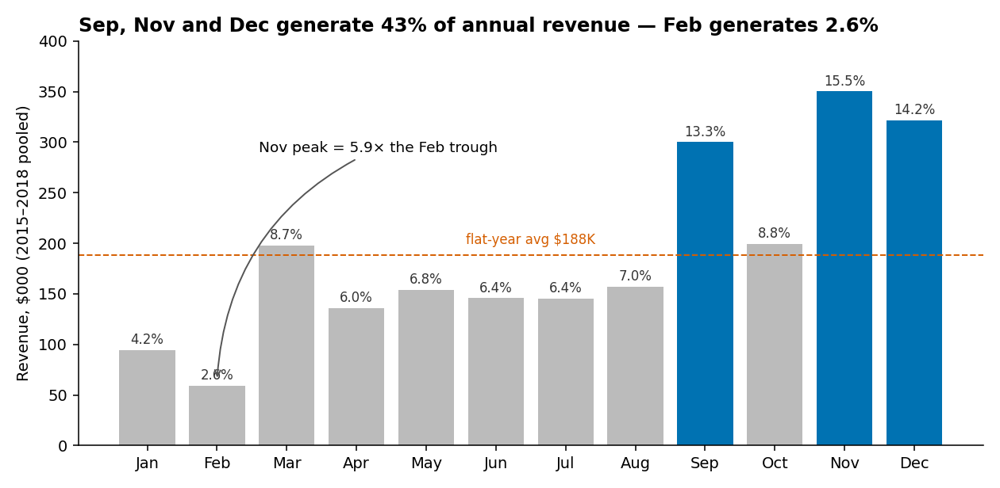
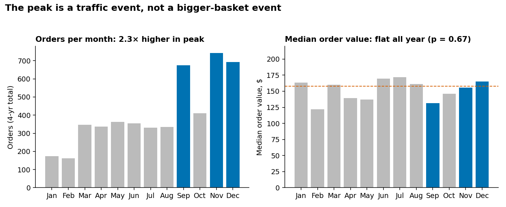
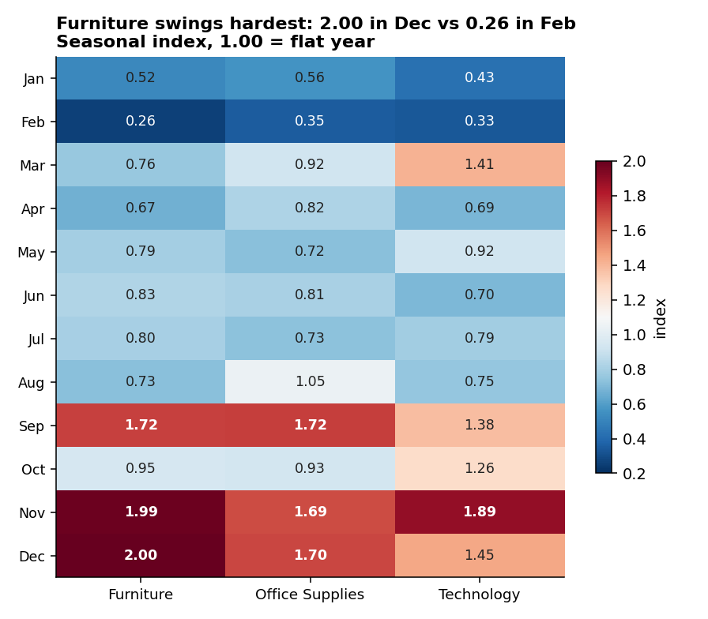
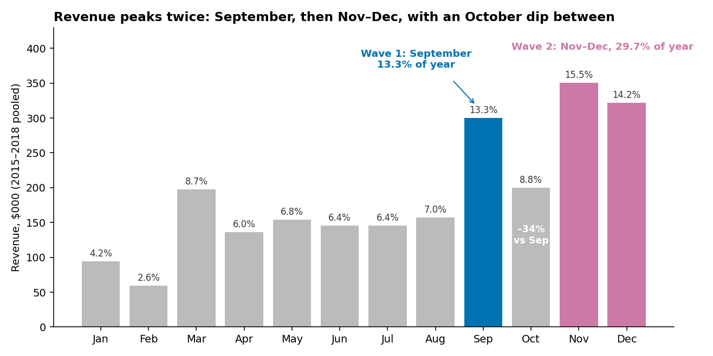
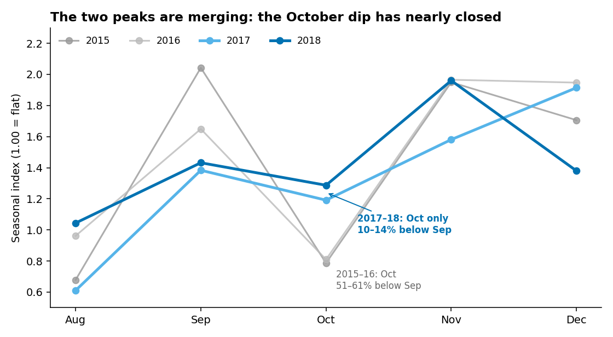
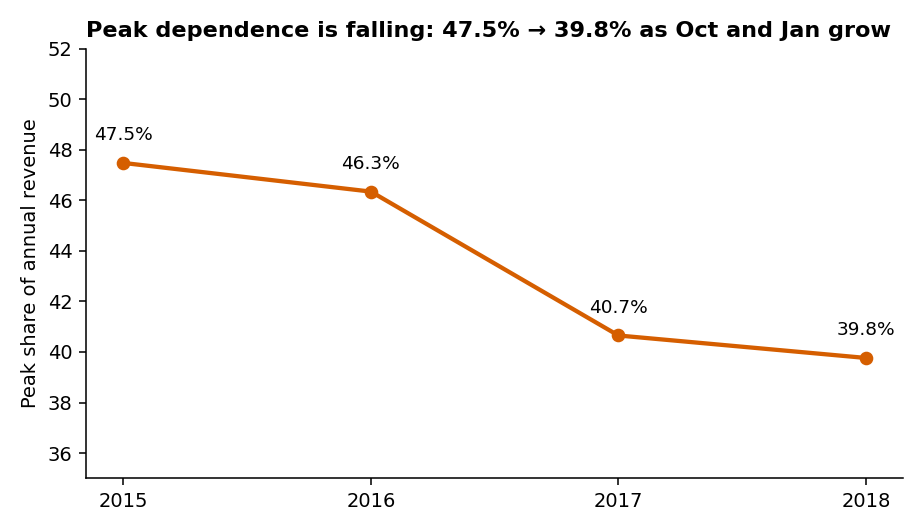

# Superstore Seasonality & Timing Analysis

**Goal** — When does revenue actually arrive, which categories drive the swing, and what should we do about the four-month dead zone?

**Headline** — Three months (Sep, Nov, Dec) generate **43% of annual revenue** — a peak driven almost entirely by more customers ordering, not by bigger baskets — while Jan–Apr delivers 21.5% of revenue for 33% of the calendar and leaves roughly **$67K a year** on the table.



---

## Three key findings

**1. The year is extremely lopsided, and it has stayed that way for four straight years.**
Sep + Nov + Dec = **43.0%** of revenue (95% CI 39.7–46.2%) against the 25.0% a flat year would give. November alone ($350K) is **5.9× February** ($59K). The pattern repeats in every one of the four years — this is structure, not a one-off.

**2. The peak is a traffic event, not a bigger-basket event.**
Peak months average **703 orders** vs 312 off-peak (2.3×) and **454 active customers in September** vs 145 in February. But the median order value is **$150.07 in peak vs $152.93 off-peak** — statistically indistinguishable (Mann-Whitney U, p = 0.67, n = 2,110 / 2,812). Lines per order are also flat (1.98 vs 2.00). More people buy; they do not buy more per trip.



**3. Furniture is the most seasonal category and the one worth phasing.**
Furniture swings from a **0.26 index in February to 2.00 in December** — a 1.74-point spread vs 1.37 for Office Supplies. Chairs (48% of revenue in peak) and Bookcases (50%) are the sharpest sub-categories. Copiers (28%) and Supplies (26%) are counter-seasonal and can carry the dead zone.



---

## Bonus finding: revenue peaks twice, and the peaks are merging

Revenue has two waves, not one: **September (13.3% of the year)** and **Nov–Dec (29.7%)**, separated by an October dip 34% below September.
But the dip is closing. October was 51–61% below September in 2015–16 and only 10–14% below in 2017–18, so the year is turning into one long season. The data cannot say why; there is no order-reason field.




---

## Recommendations

| # | Action | Grounded in | Expected effect |
|---|---|---|---|
| 1 | **Run a Feb–Mar reactivation campaign** targeting the **383 customers** who buy in the peak but never order in Feb or Mar. Basket size needs no work — only order count. | Finding 2: peak is a customer-count effect | Closing half the Jan–Apr gap ≈ **+$33K/yr**; full close ≈ +$67K/yr (observed annual gap ranged $57K–$83K) |
| 2 | **Phase Furniture inventory to the index**, not to a flat 1/12 monthly buy. Build to 2.00× baseline for Nov–Dec, hold 0.26× for Feb. | Finding 3: Furniture index 0.26 → 2.00 | Frees working capital in Q1 and reduces Nov stockout risk on Chairs/Bookcases (48% peak-loaded) |
| 3 | **Lead the Q1 offer with Copiers and Supplies**, the two counter-seasonal sub-categories (28% / 26% peak share). | Finding 3 + sub-category table | Fills the dead zone with lines that already sell in Q1, rather than pushing a Furniture offer against a 0.26 index |
| 4 | **Protect October.** October climbed from a 0.79 index in 2015 to 1.29 in 2018 — the only month materially reshaping the year. | Peak-erosion chart | Peak dependence already fell 47.5% → 39.8%; October is the mechanism, and it is worth understanding before it is disturbed |

**Measurement plan:** track `Order Count` and `Active Customers` for Jan–Apr against the 2018 baseline (174/161/346/337 orders). Do **not** track average order value as a success metric — this analysis shows it does not move seasonally, so a change there would signal something other than campaign effect.



---

## Caveats and assumptions

**What the data shows:** all revenue, order-count, category and timing figures above are direct counts from 9,799 order lines, 2015-01-03 to 2018-12-30.

**What is inferred:** that the Sep and Nov/Dec peaks are two different phenomena — a September fiscal-year-end effect (Consumer index 1.89) and a Nov/Dec holiday effect (Corporate index 2.07 in Nov). The data is consistent with this but does not prove it; no order-reason field exists.

**What is assumed:** that 2019 will retain the same seasonal shape. Four consecutive years support this, but peak share is trending down ~2.6pp/yr, so the shape is drifting.

**Known limits:**
- **No Quantity, Discount, Profit or Cost.** This is a revenue analysis only. It cannot say whether the peak is profitable, whether discounting causes it, or whether a revenue rise is volume or price.
- **Alaska and Hawaii absent**; 49 states + DC only. One retailer, not a market.
- **March Technology (index 1.41) is an artifact, not a pattern.** It is driven by two single lines — a $22,638 Machines order in 2015 and a $14,000 Copiers order in 2018. Do not plan against it.
- Outliers were **retained**, not trimmed. 19 lines exceed $5,000. Trimming them would have understated the peak, since bulk orders concentrate there.
- Sales are recognised on **order date**, not ship date. Ship-date recognition moves **$25,756 (8.0% of December)** into January; the `[Sales by Ship Date]` measure is included to test this.

---

## Transformation changelog

| Rule | Rows affected | Note |
|---|---|---|
| Loaded raw | 9,800 | |
| R1 — Drop exact duplicate line | 1 | Row 3407, order US-2015-150119; identical to 3406 on all 17 fields |
| R2 — Parse dates as `dd/mm/yyyy` | 9,799 | 0 parse failures; confirmed by day-values >12 |
| R3 — Impute Burlington VT postal = 05401 | 11 | Lookup fill; not used in any analysis |
| R4 — Canonicalise Product Name to modal name per Product ID | 125 | 32 IDs carried >1 name string; Sub-Category was already consistent |
| R5 — Derive year, month, ym, quarter, ship_lag_days, season | 9,799 | Peak defined as Sep, Nov, Dec |
| R6 — Outliers **retained** | 19 | Lines >$5,000; see caveats |

Nothing was dropped silently. Final: **9,799 rows**, reconciling to $2,261,255 total sales.

---

## Repo contents

```
README.md                          ← findings first
data/raw/train.csv                 ← original public Superstore data
data/processed/superstore_clean.csv ← cleaned, 9,799 rows
requirements.txt
sql/business_queries.sql           ← 8 commented queries (CTEs, windows, JOINs, a view)
python/profile.py                  ← data profiling
python/clean.py                    ← cleaning + changelog
python/analyze.py                  ← seasonality analysis + significance tests
python/viz.py                      ← charts 01-04
python/viz_two_peaks.py            ← charts 05-06 (two seasonal waves)
python/model.py                    ← builds the Power BI star schema
visuals/                           ← 6 PNGs, embedded in this README
powerbi/README_build_spec.md       ← page-by-page dashboard build instructions
powerbi/DAX_measures.txt           ← 25 measures incl. Seasonal Index, Peak Share, Dead Zone Gap
powerbi/data/                      ← fact_sales + 5 dimensions, 0 orphan rows
```

## Reproduction

```bash
# run every command from the repository root
pip install -r requirements.txt
python python/profile.py    # profile raw
python python/clean.py      # -> data/processed/superstore_clean.csv + changelog
python python/analyze.py    # all headline numbers
python python/viz.py        # -> visuals/01-04
python python/viz_two_peaks.py  # -> visuals/05-06
python python/model.py      # -> powerbi/data/*.csv
```

## Data dictionary — `fact_sales.csv`

| Column | Type | Description |
|---|---|---|
| LineKey | int | Unique line ID (from Row ID) |
| OrderID | text | Order identifier; 4,922 distinct |
| OrderDateKey | int | YYYYMMDD → `dim_date[DateKey]` (active) |
| ShipDateKey | int | YYYYMMDD → `dim_date[DateKey]` (inactive) |
| CustomerKey | text | → `dim_customer`; 793 distinct |
| ProductKey | text | → `dim_product`; 1,861 distinct |
| GeoKey | text | `State\|City\|PostalCode` → `dim_geography` |
| ShipModeKey | text | → `dim_shipmode`; 4 values |
| Sales | float | Line revenue, USD. Min $0.44, median $54.49, max $22,638.48 |
| ShipLagDays | int | Ship date − order date; 0–7 days |
